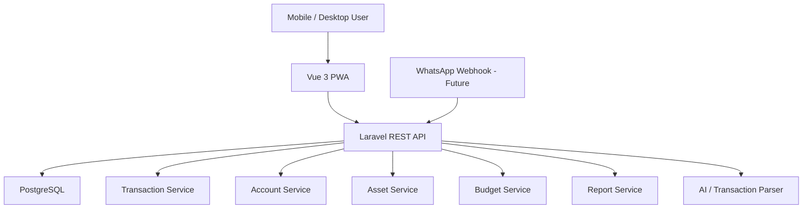

# PRD — Personal Finance & Asset Tracker

**Project codename:** Finora  
**Product type:** Personal Finance Management Web App (PWA)  
**Status:** Draft — Product Requirements  
**Platform:** Mobile-first Web, Installable PWA

---

## 1. Overview

### Product Description

A personal finance application for managing income, expenses, multiple financial accounts, transfers, budgets, and investment assets in one place. The application is designed to make financial recording quick and convenient, while providing a clear view of the user's overall financial condition.

In a future phase, users will be able to record transactions through WhatsApp using natural language. The system will parse the message into structured transaction data and either save it automatically or ask for confirmation.

### Problem Statement

Personal finances are often spread across bank accounts, cash, e-wallets, savings, and investments. This makes it difficult to:

- Know the total available balance across accounts.
- Track daily income and expenses consistently.
- Separate money for different purposes.
- Understand spending habits.
- Track investments and asset values alongside cash.
- Record transactions quickly without friction.

### Product Goals

1. Record income and expenses quickly.
2. Manage multiple accounts and wallets.
3. Track account balances accurately.
4. Separate money by purpose.
5. Track investment assets such as mutual funds.
6. Provide useful financial reports and net worth summaries.
7. Enable future transaction recording through WhatsApp.

---

## 2. Core Concepts

The application separates financial data into three primary concepts.

### 2.1 Account — Where Money Is Held

An account represents a place where money is stored or managed.

Supported account types:

| Type | Examples |
|---|---|
| Cash | Physical cash |
| Bank | BCA, Mandiri, BRI |
| E-Wallet | GoPay, DANA, OVO |
| Personal Wallet | Wallet Jajan, Wallet Kebutuhan |
| Savings | Dedicated savings |
| Investment Account | Investment platform account |
| Other | Custom account |

Accounts are user-created and customizable.

Account properties:

- Name
- Account type
- Currency
- Opening balance
- Icon
- Color
- Active/archive status

### 2.2 Transaction — Money Movement

A transaction records movement of money.

Transaction types:

- **Income** — money received
- **Expense** — money spent
- **Transfer** — money moved between accounts

Each transaction must be associated with the relevant account(s).

### 2.3 Asset — Owned Value

Assets represent investments or other owned value that should not be treated as ordinary account cash.

Examples:

- Mutual funds (reksa dana)
- Gold
- Stocks
- Deposits
- Other assets

Assets have their own valuation history and may be updated manually in the MVP.

---

## 3. Scope & Features

## 3.1 Dashboard

The dashboard provides a high-level view of the user's financial condition.

### Information displayed

- Total net worth
- Total cash and account balances
- Income for the selected period
- Expenses for the selected period
- Cash flow chart
- Expense breakdown by category
- Account balance overview
- Recent transactions

### Period filters

- Today
- This week
- This month
- This year
- Custom date range

### Dashboard requirements

- Summary cards
- Income vs expense chart
- Category spending chart
- Account balance list
- Recent transactions list
- Quick-add transaction action

## 3.2 Account Management

Users can create and manage multiple accounts.

### Features

- Create account
- Edit account
- Archive account
- Set opening balance
- Select account type
- Customize icon and color
- View current balance
- View account transaction history
- Search/filter accounts
- Mark frequently used accounts

### Account types

- Cash
- Bank
- E-Wallet
- Personal Wallet
- Savings
- Investment Account
- Other

### Example accounts

- BCA
- Mandiri
- Cash
- GoPay
- Wallet Jajan
- Wallet Kebutuhan
- Tabungan

Personal wallets are virtual allocations of money. They are still accounts and can be used as transaction sources or destinations.

## 3.3 Transaction Management

The application supports recording income and expenses.

### Transaction fields

| Field | Required | Description |
|---|---|---|
| Type | Yes | Income or Expense |
| Amount | Yes | Transaction amount |
| Account | Yes | Account used |
| Category | Yes for income/expense | Classification |
| Date | Yes | Transaction date |
| Description | No | Short description |
| Notes | No | Additional notes |
| Tags | No | Custom labels |
| Attachment | No | Receipt/image |
| Input Source | System | Manual, WhatsApp, Import |

### Features

- Add income
- Add expense
- Edit transaction
- Delete transaction
- Duplicate transaction
- Search transactions
- Filter by type, account, category, and date
- Sort by amount or date
- Attach receipt images (future/optional)
- Quick transaction input

### Quick actions

- `+ Income`
- `- Expense`
- `Transfer`

Transaction creation should be accessible directly from the dashboard.

## 3.4 Category Management

Categories group income and expenses.

### Default expense categories

- Food & Drink
- Transportation
- Shopping
- Bills
- Entertainment
- Health
- Personal
- Education
- Household
- Other

### Default income categories

- Salary
- Freelance
- Business
- Investment Return
- Gift
- Other Income

### Category features

- Create custom category
- Edit category
- Set icon and color
- Archive category
- Filter transaction history by category

## 3.5 Transfers

Transfers move money between accounts without counting as income or expenses.

### Transfer fields

- Source account
- Destination account
- Amount
- Date
- Description
- Transfer fee (optional)

### Business rules

- Source and destination must be different.
- Source balance decreases.
- Destination balance increases.
- Transfer does not affect income or expense reports.
- Transfer fees, if any, are recorded as expenses.

### Example

Transfer Rp500,000 from BCA to Wallet Jajan:

- BCA: -Rp500,000
- Wallet Jajan: +Rp500,000
- Income: unchanged
- Expense: unchanged

## 3.6 Budget Management

Users can set spending limits by category and period.

### Features

- Monthly budget
- Weekly budget (optional)
- Budget by expense category
- Amount spent
- Remaining budget
- Percentage used
- Warning when nearing the limit
- Notification when budget is exceeded
- Budget history

### Example

| Category | Budget | Used | Remaining |
|---|---:|---:|---:|
| Food | Rp1,000,000 | Rp650,000 | Rp350,000 |
| Transportation | Rp500,000 | Rp200,000 | Rp300,000 |
| Shopping | Rp500,000 | Rp400,000 | Rp100,000 |
| Entertainment | Rp300,000 | Rp100,000 | Rp200,000 |

Budgets are based on spending categories rather than accounts.

## 3.7 Asset & Investment Tracking

Users can record assets separately from their cash accounts.

### Asset types

- Mutual Fund (Reksa Dana)
- Gold
- Stocks
- Deposit
- Other

### Asset fields

| Field | Description |
|---|---|
| Name | Asset name |
| Type | Asset type |
| Provider | Platform/provider |
| Units | Quantity/units owned |
| Average Buy Price | Average purchase price per unit |
| Current Price | Current price per unit |
| Total Value | Current total value |
| Invested Capital | Total capital invested |
| Purchase Date | Purchase date |
| Notes | Additional notes |

### Asset features

- Add asset
- Edit asset
- Update units
- Update current price/value
- Store valuation history
- Calculate profit/loss
- Calculate return percentage
- View asset allocation
- Include asset value in net worth

### Mutual fund example

| Item | Value |
|---|---:|
| Asset | Money Market Mutual Fund |
| Units | 1,250 |
| Average Buy | Rp1,200 |
| Current NAV | Rp1,250 |
| Current Value | Rp1,562,500 |
| Invested Capital | Rp1,500,000 |
| Profit | Rp62,500 |
| Return | 4.17% |

Formulas:

- Current Value = Units × Current Price
- Profit/Loss = Current Value − Invested Capital
- Return (%) = (Profit/Loss ÷ Invested Capital) × 100

In the MVP, asset valuations are entered manually. Automatic NAV/pricing integrations can be added later.

### Investment accounting

Buying an investment should not be treated as ordinary consumption.

Example:

- BCA before purchase: Rp5,000,000
- Buy mutual fund: Rp1,000,000
- BCA after purchase: Rp4,000,000
- Mutual fund asset: Rp1,000,000

Total wealth remains Rp5,000,000 before fees and price changes.

Investment purchases should be recorded as a movement from a cash account to an asset. They may be shown separately in cash-flow reports as investment outflows, but should not be treated as consumption expenses in net worth calculations.

## 3.8 Transaction History

A dedicated page displays all transactions.

### Features

- Search
- Filter by income, expense, or transfer
- Filter by account
- Filter by category
- Filter by date
- Sort by date or amount
- Edit transaction
- Delete transaction
- Duplicate transaction

### Transaction display

Each transaction displays:

- Date
- Description
- Category
- Account
- Amount
- Transaction type

## 3.9 Reports & Analytics

The application provides insights into financial activity.

### Reports

- Income vs Expense
- Monthly Cash Flow
- Expense by Category
- Expense by Account
- Daily Spending
- Monthly Comparison
- Net Worth History
- Asset Allocation
- Income History
- Savings Rate

### Metrics

**Net Cash Flow**

`Income − Expense`

**Savings Rate**

`((Income − Expense) ÷ Income) × 100%`

**Net Worth**

`Total Assets − Total Liabilities`

Reports must support period filtering.

## 3.10 Recurring Transactions

Users can configure recurring income or expenses.

Examples:

- Monthly salary
- Internet bill
- Subscription
- Installments
- Recurring payments

### Configuration

- Type
- Amount
- Category
- Account
- Start date
- Frequency
- Optional end date

### Frequency

- Daily
- Weekly
- Monthly
- Yearly

Recurring transactions should be generated through scheduled processing. Duplicate generation must be prevented.

---

## 4. Phase 2 — WhatsApp Finance Assistant

WhatsApp-based recording is a future feature and should not block the initial release.

### 4.1 Natural Language Input

Users can send transaction messages using ordinary language.

Examples:

**Expense**

- `beli kopi 20 ribu pakai gopay`
- `makan siang 35rb wallet jajan`
- `bayar listrik 250 ribu dari bca`

**Income**

- `gaji 5 juta masuk bca`
- `freelance 750 ribu mandiri`
- `dapat cashback 15rb gopay`

**Transfer**

- `transfer 500 ribu dari bca ke wallet jajan`
- `pindahin 200rb wallet jajan ke cash`

**Investment**

- `beli reksadana 500 ribu dari bca`
- `tambah investasi pasar uang 1 juta`

### 4.2 Parsing requirements

The system should extract:

- Transaction type
- Amount
- Description
- Account
- Destination account (for transfer)
- Category
- Date
- Notes (optional)

### 4.3 Example parsed result

Input:

`beli makan 25 ribu wallet jajan`

Parsed data:

```json
{
  "type": "expense",
  "amount": 25000,
  "description": "Beli makan",
  "account": "Wallet Jajan",
  "category": "Food & Drink",
  "date": "2026-11-21"
}
```

### 4.4 WhatsApp processing flow

1. User sends a message.
2. WhatsApp provider receives it.
3. Webhook forwards it to the backend.
4. Backend parses the message.
5. AI or parser extracts transaction data.
6. Account and category names are matched.
7. Data is validated.
8. If ambiguous, bot requests clarification.
9. Transaction is saved or awaits user confirmation.
10. Bot sends a receipt/confirmation response.

### 4.5 Confirmation mode

Initially, transactions should require confirmation before saving.

The system should request clarification when:

- Account is missing.
- Amount is unclear.
- Transaction type is ambiguous.
- Transfer destination is missing.
- Account/category match is uncertain.
- Amount appears unusually large.

Auto-save can later be enabled for low-risk transactions that meet configured rules.

### 4.6 Duplicate prevention

WhatsApp message processing must be idempotent.

The same incoming webhook/message must not create multiple transactions if it is retried by the provider.

---

## 5. Application Navigation

### Desktop

- Dashboard
- Transactions
- Accounts
- Assets
- Budgets
- Reports
- Settings

### Mobile

Bottom navigation:

- Home
- Activity
- Add
- Accounts
- Assets

The Add action should open a quick transaction selector for Income, Expense, and Transfer.

---

## 6. Recommended Tech Stack

### Frontend

| Technology | Purpose |
|---|---|
| Vue 3 | UI framework |
| TypeScript | Type safety |
| Vite | Development/build |
| Vue Router | Routing |
| Pinia | Client state |
| TanStack Vue Query | API data fetching and caching |
| Tailwind CSS | Styling |
| shadcn-vue | UI components |
| Lucide Vue | Icons |
| Chart.js | Charts |
| VeeValidate + Zod | Form validation |

### Backend

| Technology | Purpose |
|---|---|
| Laravel | REST API & backend logic |
| PHP | Backend runtime |
| PostgreSQL | Database |
| Laravel Sanctum | Authentication |
| Laravel Scheduler | Scheduled jobs |
| Laravel Queue | Background processing |
| Redis | Optional cache/queue |
| Webhooks | Future WhatsApp integration |

### PWA

| Technology | Purpose |
|---|---|
| vite-plugin-pwa | PWA configuration |
| Web App Manifest | Installability |
| Workbox | Service worker/caching |
| IndexedDB | Offline data storage |

### Recommended architecture



### Deployment

| Component | Recommendation |
|---|---|
| Frontend | Static build served via Nginx |
| Backend | Laravel |
| Database | PostgreSQL |
| Hosting | VPS |
| Reverse Proxy | Nginx |
| SSL | Let's Encrypt |
| Deployment | Docker Compose |
| Backup | Scheduled database backup |

---

## 7. Database Design

### 7.1 `accounts`

| Column | Type |
|---|---|
| id | UUID |
| user_id | UUID |
| name | VARCHAR |
| type | ENUM |
| currency | VARCHAR |
| initial_balance | DECIMAL |
| icon | VARCHAR |
| color | VARCHAR |
| is_active | BOOLEAN |
| created_at | TIMESTAMP |

### 7.2 `categories`

| Column | Type |
|---|---|
| id | UUID |
| user_id | UUID |
| name | VARCHAR |
| type | income / expense |
| icon | VARCHAR |
| color | VARCHAR |
| is_active | BOOLEAN |

### 7.3 `transactions`

| Column | Type |
|---|---|
| id | UUID |
| user_id | UUID |
| account_id | UUID |
| category_id | UUID nullable |
| type | income / expense |
| amount | DECIMAL |
| description | VARCHAR |
| notes | TEXT nullable |
| transaction_date | TIMESTAMP |
| input_source | manual / whatsapp / import |
| created_at | TIMESTAMP |
| updated_at | TIMESTAMP |

### 7.4 `transfers`

| Column | Type |
|---|---|
| id | UUID |
| user_id | UUID |
| source_account_id | UUID |
| destination_account_id | UUID |
| amount | DECIMAL |
| fee | DECIMAL |
| description | VARCHAR |
| transfer_date | TIMESTAMP |

### 7.5 `assets`

| Column | Type |
|---|---|
| id | UUID |
| user_id | UUID |
| name | VARCHAR |
| type | mutual_fund / gold / stock / deposit / other |
| provider | VARCHAR nullable |
| units | DECIMAL |
| average_buy_price | DECIMAL |
| current_price | DECIMAL |
| invested_amount | DECIMAL |
| current_value | DECIMAL |
| currency | VARCHAR |
| notes | TEXT |
| is_active | BOOLEAN |

### 7.6 `asset_valuations`

| Column | Type |
|---|---|
| id | UUID |
| asset_id | UUID |
| valuation_date | DATE |
| unit_price | DECIMAL |
| total_value | DECIMAL |
| created_at | TIMESTAMP |

### 7.7 `budgets`

| Column | Type |
|---|---|
| id | UUID |
| user_id | UUID |
| category_id | UUID |
| amount | DECIMAL |
| period | monthly / weekly |
| start_date | DATE |
| end_date | DATE nullable |

### 7.8 Future WhatsApp tables

- `whatsapp_messages`
- `pending_transactions`
- `whatsapp_integrations`

These tables will store inbound messages, parsing results, confirmation status, and webhook processing state.

---

## 8. Financial Business Rules

### 8.1 Account balance

Account balance should be calculated based on opening balance and account movements.

`Balance = Initial Balance + Income − Expense + Transfer In − Transfer Out`

### 8.2 Transaction rules

- Income increases account balance.
- Expense decreases account balance.
- Transfer decreases the source and increases the destination.
- Transfer is excluded from income and expense reports.
- Amount must be greater than zero.
- Every transaction has a date.
- Editing a transaction must correctly update its financial impact.
- Deleting a transaction must reverse its financial impact.
- Transactions must belong to the authenticated user.
- Accounts with historical transactions should be archived rather than permanently deleted.

### 8.3 Investment rules

- Investment purchases should be recorded as cash-to-asset movements.
- Investment purchases must not be treated as ordinary consumption.
- Asset value contributes to net worth.
- Asset valuation changes must be trackable.
- Reports may separately display investment cash outflow.

### 8.4 Data integrity

- Transfer must be atomic.
- Transactions must be processed inside database transactions when necessary.
- Account balance must not become inconsistent after partial failures.
- Webhook retries must not create duplicates.
- Financial amounts should use decimal types, not floating-point types.

---

## 9. Non-Functional Requirements

### Performance

- Fast dashboard loading.
- Responsive transaction input.
- Pagination for transaction history.
- Efficient date-filtered queries.
- Lazy loading where appropriate.
- Avoid fetching unnecessary historical data for charts.

### Security

- Authentication required.
- User data isolation.
- Backend validation.
- Rate limiting.
- CSRF protection where applicable.
- Secrets must never be exposed to frontend.
- Database must not be publicly accessible.
- Sensitive information must be protected.

### Reliability

- Atomic transfers.
- Consistent balance calculations.
- Duplicate webhook prevention.
- Database backups.
- Audit trail for changes to financial records.

### PWA

- Installable on Android and desktop.
- Responsive mobile-first interface.
- Offline application shell.
- Cache static assets.
- Optional offline transaction entry using IndexedDB.
- Synchronize queued transactions when connection returns.

---

## 10. Development Phases

### Phase 1 — Core Finance (MVP)

- Authentication
- Account CRUD
- Category CRUD
- Income
- Expense
- Transfer
- Transaction history
- Balance calculation

### Phase 2 — Dashboard & Budget

- Dashboard summary
- Cash flow charts
- Category spending charts
- Account summary
- Budget management
- Monthly reports

### Phase 3 — Assets & Investment

- Asset management
- Mutual fund tracking
- Manual valuation
- Profit/loss calculation
- Net worth
- Asset allocation

### Phase 4 — PWA & Offline

- Installable PWA
- Offline application shell
- Offline transaction input
- Synchronization
- Optional notifications

### Phase 5 — WhatsApp Assistant

- WhatsApp webhook
- Natural language parser
- AI transaction extraction
- Account/category matching
- Confirmation flow
- Configurable auto-save
- Duplicate message prevention

---

## 11. MVP Acceptance Criteria

- [ ] User can register/login/logout.
- [ ] User can create multiple accounts.
- [ ] User can create Cash, Bank, E-Wallet, and Personal Wallet accounts.
- [ ] User can set an opening balance.
- [ ] User can record income.
- [ ] User can record expense.
- [ ] User can select an account for each transaction.
- [ ] Account balance updates correctly.
- [ ] User can transfer money between accounts.
- [ ] Transfers are excluded from income/expense totals.
- [ ] User can edit and delete transactions.
- [ ] Account balances remain correct after edits/deletions.
- [ ] User can view transaction history.
- [ ] User can filter by date, account, and category.
- [ ] User can create custom categories.
- [ ] User can view income/expense summaries.
- [ ] User can create budgets.
- [ ] User can create mutual fund assets.
- [ ] User can update asset valuations.
- [ ] User can view total assets and net worth.
- [ ] Application can be installed as a PWA.
- [ ] Application is usable on mobile devices.

---

## 12. UI & Design Direction

### Design principles

- Minimalist
- Mobile-first
- Clean layouts
- Plenty of whitespace
- Financial figures are prominent
- Simple cards
- Avoid excessive tables on mobile
- Bottom navigation on mobile
- Sidebar navigation on desktop
- Quick-add action always accessible

### Visual direction

- Neutral base colors
- Forest green as primary accent
- Clear income/expense distinction
- Consistent spacing and typography
- Avoid overly decorative gradients
- Focus on readability

### Reference products

- Wallet by BudgetBakers — account and transaction management
- Monarch Money — dashboard, net worth, budgeting, financial visualization
- Money Manager — expense recording and account management

---

## 13. Out of Scope for MVP

The following features should not be included initially:

- Automatic bank integration
- Real-time bank synchronization
- AI financial advisor
- Cryptocurrency tracking
- Multi-user household finance
- Complex double-entry accounting interface
- Multi-currency support
- Automatic integration with every investment provider
- Automatic mutual fund price integration

These features may be considered after the core finance system is stable.

---

## 14. Product Vision

> One place for all your money.

A personal finance app that lets users understand where their money is, where it goes, how much they own, and how their financial condition changes over time.

The application should make tracking money simple enough to become a daily habit.

---

## 15. Recommended Build Order

Build the financial foundation first, not the charts.

1. Database & authentication
2. Account management
3. Categories
4. Income & expense
5. Transfer
6. Balance calculation & integrity
7. Transaction history
8. Dashboard
9. Budget
10. Asset tracking
11. PWA/offline enhancements
12. WhatsApp integration

The account, transaction, and transfer systems must be reliable before reports, net worth, and automation are added.

---

## Final Stack

- **Frontend:** Vue 3 + Vite + TypeScript
- **Backend:** Laravel REST API
- **Database:** PostgreSQL
- **Styling:** Tailwind CSS
- **Components:** shadcn-vue
- **State:** Pinia
- **API State:** TanStack Vue Query
- **Charts:** Chart.js
- **Validation:** VeeValidate + Zod
- **PWA:** vite-plugin-pwa + Workbox
- **Deployment:** Docker Compose + Nginx on VPS

